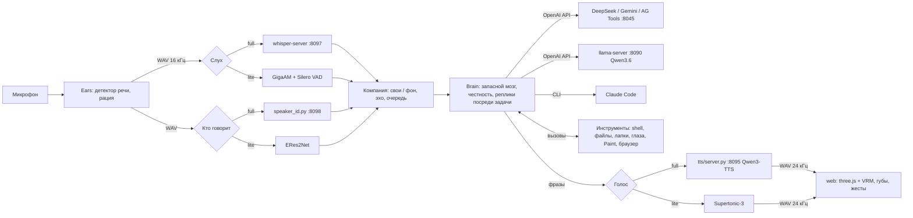

# Клава — железо, скорости, устройство

Все цифры — замеры на машинах, где Клава реально работала (сентябрь 2026), а не с сайтов производителей.

## Минимальные и рекомендуемые требования

| Уровень | Железо | Что работает |
|---|---|---|
| **Ноутбук / «калькулятор»** | 4 ядра x64 с AVX2, 8 ГБ ОЗУ, любая видеокарта (для аватара хватит встроенной), интернет | Лёгкий слух и голос на процессоре + облачный мозг (DeepSeek / Gemini / AG Tools). Всё, кроме своего мозга. |
| **Средний ПК** | 6–8 ядер, 32 ГБ ОЗУ, любая видеокарта | + свой мозг Qwen3.6 в кванте IQ3_M (~14 ГБ) — медленно, но без интернета и цензуры |
| **Как у автора** | Xeon E5-2667 v4 (8 ядер / 16 потоков, 3,2 ГГц), 64 ГБ DDR4-2667 (2 канала), RTX 3060 12 ГБ, NVMe | Большой голос и слух на видеокарте + свой мозг Qwen3.6 Q6_K_P |

ОС: Windows 10 1809+ или 11, x64. Нужны .NET 9 и WebView2 (ставит `УСТАНОВИТЬ.bat`).

## Лёгкий комплект (процессор, без Python)

sherpa-onnx 1.13.8 (ONNX Runtime) прямо в процессе KlavaDesk, 4 потока на модель. Замер на Xeon E5-2667 v4:

| Модель | Размер | Загрузка | Скорость |
|---|---|---|---|
| Слух: GigaAM v3 CTC с пунктуацией (int8) + Silero VAD | 160 МБ + 1 МБ | 1,6 с | фраза 8 с — 0,4 с; 3,5 с — 0,25 с |
| Голос: Supertonic-3 (int8), голос F2, высота 1,06 | 130 МБ | 1,2–1,5 с | RTF 0,29–0,39 (в 3 раза быстрее речи), 8 шагов |
| Запасной голос: Piper «Ирина» (VITS int8) | 20 МБ | — | RTF 0,41 |
| Кто говорит: ERes2Net (3D-Speaker, VoxCeleb) | 25 МБ | 0,3 с | 84 мс на запись |

Весь комплект — **~350 МБ на диске, ~0,8 ГБ ОЗУ**, старт Клавы ~5 с.

Голосовые профили, живые записи друзей: своя запись к своему профилю — близость 0,51–0,83, к чужому — не выше 0,39;
порог «свой» 0,45 — ни одной ошибки на 24 своих и 108 чужих парах. Модели wespeaker (CAM++, ResNet34) через sherpa
на тех же записях ошибались в 20–40 % пар — поэтому 3D-Speaker.

Голос для лёгкого комплекта выбран по близости к её большому голосу (отпечаток ERes2Net): F2 на высоте 1,06 — 0,49,
F1 — 0,47, остальные ниже. Высота меняется без смены темпа: синтез медленнее в 1,06 раза + ускоренное проигрывание.

## Большой комплект (видеокарта NVIDIA)

| Часть | Модель | Видеопамять | Скорость |
|---|---|---|---|
| Слух | whisper.cpp large-v3-turbo q5_0 | ~0,9 ГБ | фраза — 0,5–0,9 с |
| Голос | Qwen3-TTS 12Hz 1.7B Base + LoRA ударений (faster-qwen3-tts, CUDA-графы), знаки — RUAccent turbo3.1 | ~4,5 ГБ пик | RTF 0,7–0,8 на RTX 3060; старт ~35 с; ударение не там на трудных словах 2,5 % против 9 % у 0.6B (tts/stress_check.py) |
| Кто говорит | WavLM base plus sv | на процессоре | 0,1–0,3 с |

Голос, слух и профили вместе с рабочим столом занимают ~2,7 ГБ видеопамяти.

## Свой мозг: Qwen3.6-35B-A3B uncensored

MoE: 35B параметров, на каждый токен считаются 3B (256 экспертов, 40 слоёв, внимание полное в каждом четвёртом
слое — 32К контекста стоят меньше гигабайта). Зрение — mmproj f16, на процессоре.

Квант по ОЗУ (`tools\fetch_brain.ps1`): от 56 ГБ — Q6_K_P (28,5 ГБ), от 40 — Q4_K_P (21,8 ГБ), от 28 — IQ3_M (14,4 ГБ),
от 20 — IQ2_M (10,9 ГБ).

llama-server сам делит память (`--fit`): все 41 слой на видеокарте, эксперты — сколько влезет, остальные в ОЗУ.
Замер на RTX 3060 12 ГБ + DDR4-2667 ×2, Q6_K_P:

| | |
|---|---|
| Раскладка | общие слои + эксперты 11 из 40 слоёв на видеокарте (~9,5 ГБ), 30 слоёв экспертов в ОЗУ |
| Загрузка с NVMe | 30–50 с |
| Генерация | **11–12 токенов/с** на прогретой модели (первый запрос медленнее: страницы экспертов подтягиваются с диска) |
| Чтение промпта | 41 т/с — короткий ход; 25 т/с — большой промпт (характер целиком) |

`--no-op-offload` стоит сознательно: иначе на каждый кусок промпта веса экспертов гонятся из ОЗУ на видеокарту
по шине — короткий ход читался 10–21 т/с. Целиком на 12 ГБ модель не влезает: «задрать ngl» уже некуда, все слои
и так на видеокарте, в ОЗУ остаются эксперты. Запас видеопамяти `--fit` считает сам: голос уже работает — 1,5 ГБ,
ещё не поднят — плюс 2,4 ГБ под него.

Для живого разговора быстрее облачный мозг (DeepSeek: первая фраза 1,1–2,2 с). Своя локалка — для приватного,
без интернета и без цензуры, для кода; если она думает дольше 12 с, фразу подхватывает запасной мозг.

## Устройство

Порты: 8090 — свой мозг, 8095 — большой голос, 8097 — whisper, 8098 — голосовые профили, 8045 — Antigravity Tools,
5173 — отладочный сервер страницы аватара (`node tools\devserver.mjs`).

Файлы Клавы: `klava.json` — настройки (создаётся сам), `data\history.json` — память разговора,
`data\flight_log_*.md` — полётный журнал дня, `data\speakers\` — записи голосов друзей, `data\logs\` — журналы.
